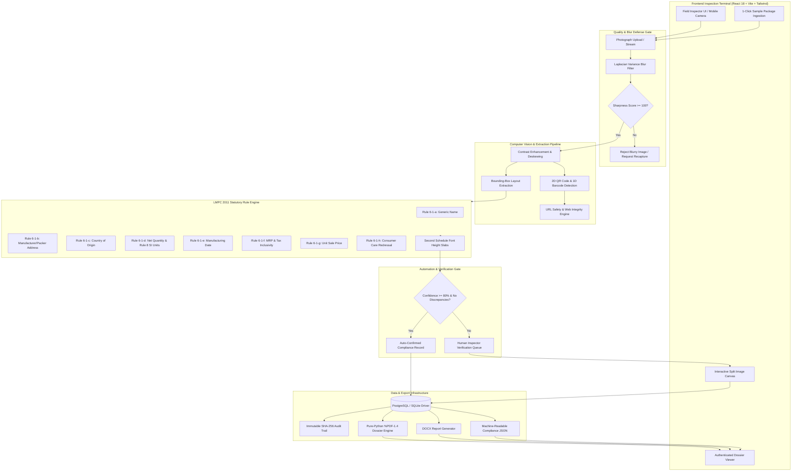

# PackCheck AI — Legal Metrology Compliance Inspection Platform

[](https://opensource.org/licenses/MIT)
[](https://python.org)
[](https://fastapi.tiangolo.com)
[](https://react.dev)
[](https://www.typescriptlang.org)
[](https://tailwindcss.com)
[](https://consumeraffairs.nic.in)
[](https://package-scanner-rust.vercel.app/)

> **PackCheck AI** is an institutional-grade, AI-assisted compliance inspection and enforcement platform engineered for the **Legal Metrology (Packaged Commodities) Rules, 2011** and the **Legal Metrology Act, 2009** (Govt. of India). It automates the extraction, verification, font-height validation, and statutory reporting of mandatory packaged commodity declarations.

---

## Live Deployment & Repository

- **Production URL:** [https://package-scanner-rust.vercel.app/](https://package-scanner-rust.vercel.app/)
- **GitHub Repository:** [https://github.com/akash2025it-gif/Package-Scanner](https://github.com/akash2025it-gif/Package-Scanner)
- **Primary Branch:** `main`

---

## Executive Summary & Problem Statement

Pre-packaged goods sold across physical retail markets and digital e-commerce marketplaces in India are legally mandated to declare essential consumer protections on their packaging under **Rule 6 of the Legal Metrology (Packaged Commodities) Rules, 2011**. 

Enforcement officers face significant operational bottlenecks:
1. **Manual Inspection Bottlenecks:** Officers inspect millions of Stock Keeping Units (SKUs) by hand with magnifying gauges, leading to subjective error and low inspection throughput.
2. **Deceptive Phrasing & Unit Violations:** Manufacturers frequently use prohibited non-SI abbreviations (e.g., `gms`, `kgs`, `ltrs` instead of standard `g`, `kg`, `ml`), omit required tax declarations (selling above MRP or excluding tax), or conceal consumer care contacts.
3. **Blur & Hallucination Defense:** Traditional OCR pipelines fail on blurry camera captures or low-contrast foils, generating inaccurate compliance assessments.
4. **Verifiable Audit Records:** Prosecution and seizure proceedings under Section 15 & Section 36 of the Legal Metrology Act require immutable evidentiary dossiers with cryptographic audit trails.

**PackCheck AI** resolves these challenges with a deterministic, multi-stage computer vision and statutory rule engine that validates packaging photographs against Indian Legal Metrology regulations in seconds.

---

## System Architecture



---

## Statutory Legal Metrology Reference Matrix

PackCheck AI deterministically inspects every commodity against the statutory mandates of the **Legal Metrology (Packaged Commodities) Rules, 2011**:

| Statutory Rule | Mandatory Legal Declaration | Legal Metrology Standard | Validation Logic | Severity |
| :--- | :--- | :--- | :--- | :--- |
| **Rule 6(1)(a)** | Generic or Common Name | Common name of contained goods | Must not rely solely on brand names (e.g. "Cold Pressed Mustard Oil") | **Critical** |
| **Rule 6(1)(b)** | Manufacturer / Packer / Importer | Complete legal entity name and physical address | Street, City, State, and PIN code mandatory | **Critical** |
| **Rule 6(1)(c)** | Country of Origin | Country where goods were manufactured | "Made in India", "Country of Origin: [Country]" | **Critical** |
| **Rule 6(1)(d) & Rule 8** | Net Quantity & Units | Standard SI metric units of mass or volume | Prohibits non-standard units (e.g., `gms`, `kgs`, `ltrs`). Standard: `g`, `kg`, `ml`, `l`, `N` | **Critical** |
| **Rule 6(1)(e)** | Date of Manufacture / Packing | Month and Year of manufacture or packing | Standardized date formats: `MM/YYYY`, `Month YYYY`, `DD/MM/YYYY` | **Major** |
| **Rule 6(1)(f)** | Maximum Retail Price (MRP) | Indian Rupees inclusive of all taxes | Mandatory currency symbol (`₹` or `Rs.`) followed strictly by `"Inclusive of all taxes"` | **Critical** |
| **Rule 6(1)(g)** | Unit Sale Price (USP) | Price per standard unit of mass/volume | Mandatory for packages over 1kg or 1L (e.g., `₹ 0.18 / g`) | **Major** |
| **Rule 6(1)(h)** | Consumer Care Redressal | Consumer grievance resolution point | Name, designation, working phone number, and official email required | **Major** |
| **Second Schedule** | Minimum Numeral Height | Minimum font height for declarations on PDP | Slabs: 1.0mm (≤50g), 1.5mm (50-100g), 2.0mm (100-200g), 4.0mm (200-500g), 6.0mm (>500g) | **Major** |

---

## Core Platform Features

### 1. Pre-OCR Image Clarity & Blur Defense
To protect against OCR hallucinations and false positives, every uploaded image is passed through a discrete 2D Laplacian kernel:
$$\text{Variance} = \frac{1}{N}\sum (L(x,y) - \mu)^2$$
Photographs failing the clarity threshold ($\text{Score} < 100.0$) are blocked at ingestion with clear user guidance.

### 2. 1-Click Interactive Evaluator Demo
Zero-friction testing for reviewers, recruiters, and evaluators. Clicking **"Load Sample Package"** automatically stages a high-resolution genuine packaging photograph (*Himalayan Harvest Pure Cold Pressed Mustard Oil*), prefills inspection metadata, passes the blur defense gate, and triggers the full compliance pipeline.

### 3. Interactive Split Canvas & Declaration Override
- **Left Panel:** High-resolution zoomable image canvas displaying package photographs with interactive bounding-box pins.
- **Right Panel:** Detailed commodity profile, decoded 1D/2D QR and barcode contents with URL safety indicator.
- **Statutory Audit Table:** Color-coded status badges (`COMPLIANT`, `NON-COMPLIANT`, `NEEDS REVIEW`), confidence percentages, and inline override modal for authorized officers.

### 4. Enterprise RBAC & Multi-Instance Resilience
- Strictly enforced Role-Based Access Control (`admin`, `inspector`, `reviewer`, `viewer`).
- Deterministic RFC 4122 v5 UUID provisioning for seeded officers (`uuid.uuid5(uuid.NAMESPACE_DNS, ...)`), eliminating false 401 logouts across multi-instance serverless cold starts.
- Safe 401 interception: only session-destroying endpoints (`/auth/me`, `/auth/refresh`) invalidate authentication tokens, preventing infinite redirect loops.

### 5. Multi-Format Verifiable Dossier Generation
- **PDF Dossier:** Pure-Python binary generator outputting 100% compliant `%PDF-1.4` statutory certificates without heavy C-dependencies.
- **DOCX Dossier:** Editable Microsoft Word compliance report.
- **JSON Report:** Machine-readable compliance report for external regulatory integration.
- **Print View:** Dedicated `@media print` stylesheet for clean physical printing.

---

## Technology Stack

| Layer | Technologies |
| :--- | :--- |
| **Frontend Framework** | React 18.3, TypeScript 5.4, Vite 5.4 |
| **Styling & Design System** | Tailwind CSS 3.4, Lucide React, Custom Dark-Navy & Slate Palette |
| **Backend Framework** | FastAPI 0.111+, Starlette, Python 3.14+ |
| **Database & ORM** | SQLAlchemy 2.0 (Async), PostgreSQL / SQLite Dual-Mode Driver |
| **Computer Vision** | OpenCV 5.0, NumPy, Discrete 2D Laplacian Blur Filter |
| **Barcode & QR Decoding** | Native OpenCV QRCode & Barcode Detectors, URL Safety Evaluator |
| **Document Generation** | Pure-Python `%PDF-1.4` Binary Engine, python-docx, Jinja2 |
| **Testing & QA** | Pytest, pytest-asyncio, HTTPX Async ASGI Transport (117+ Tests Passing) |
| **Deployment Target** | Vercel Serverless (Edge Routing, Python Functions, Static Vite SPA) |

---

## Directory Structure

```
├── backend/
│   ├── app/
│   │   ├── api/v1/          # REST Endpoints (auth, scans, reports, analytics, rules)
│   │   ├── core/            # Config, security, database initialization, RBAC
│   │   ├── models/          # SQLAlchemy async database models
│   │   ├── rules/           # LMPC 2011 Statutory Rule Engine
│   │   ├── schemas/         # Pydantic v2 data models & request/response schemas
│   │   ├── services/        # Vision pipeline, OCR, QR decoder, report generators
│   │   ├── static/          # Fallback server static HTML assets
│   │   ├── templates/       # Jinja2 report templates
│   │   └── main.py          # FastAPI application entry point
│   ├── tests/               # Pytest regression suite (117+ passing tests)
│   └── test_packaged_commodity.jpg
├── frontend/
│   ├── src/
│   │   ├── components/      # UI components (ImageCanvas, Navbar, Sidebar, AppLayout)
│   │   ├── context/         # AuthContext with hardened session restore
│   │   ├── pages/           # Dashboard, NewScan, ScanDetail, History, Reports, Rules, etc.
│   │   ├── services/        # Typed API service client
│   │   ├── types/           # TypeScript domain definitions
│   │   ├── App.tsx          # Client-side router configuration
│   │   └── index.css        # Base styles, print stylesheet, custom scrollbars
│   ├── package.json
│   ├── tailwind.config.js
│   └── vite.config.ts
├── api/
│   └── index.py             # Vercel serverless function entrypoint
├── vercel.json              # Vercel routing & build configuration
└── README.md
```

---

## Getting Started (Local Development)

### Prerequisites
- **Python 3.10+** (tested on Python 3.14)
- **Node.js 18+** & **npm**

### 1. Clone Repository
```bash
git clone https://github.com/akash2025it-gif/Package-Scanner.git
cd Package-Scanner
```

### 2. Backend Setup
```bash
# Create and activate virtual environment
python -m venv venv
source venv/bin/activate   # On Windows: .\venv\Scripts\Activate.ps1

# Install dependencies
pip install -r backend/requirements.txt

# Configure environment variables
# Create .env in the root or backend/ directory (see Environment Reference below)
```

Run database migrations and start the backend development server:
```bash
uvicorn backend.app.main:app --host 127.0.0.1 --port 8000 --reload
```

### 3. Frontend Setup
```bash
cd frontend
npm install
npm run dev
```
The application will launch at `http://localhost:5173`.

### 4. Running Backend Tests
Execute the comprehensive Pytest suite:
```bash
pytest backend/tests/ -v
```

---

## Authorized Demo Credentials

For immediate evaluation, the database auto-seeds the following test accounts:

| Role | Email | Password | Scope |
| :--- | :--- | :--- | :--- |
| **Authorized Inspector** | `inspector.sharma@packcheck.gov.in` | `inspector123` | Full scanning, editing, and report generation |
| **System Administrator** | `admin@packcheck.gov.in` | `admin123` | Global automation thresholds, RBAC, analytics |

*(Note: Production deployments require `INITIAL_INSPECTOR_PASSWORD` and `INITIAL_ADMIN_PASSWORD` to be explicitly supplied via secure environment variables; fallback passwords are automatically deactivated in production mode).*

---

## Production Environment Variables

| Variable | Required | Default / Description |
| :--- | :--- | :--- |
| `SECRET_KEY` | **Yes (in prod)** | Cryptographically secure random secret (min 32 bytes) for JWT signing. |
| `APP_ENV` | Optional | `development` / `production` |
| `DATABASE_URL` | Optional | PostgreSQL connection string (`postgresql+asyncpg://...`). Defaults to SQLite in local development. |
| `INITIAL_ADMIN_EMAIL` | Optional | `admin@packcheck.gov.in` |
| `INITIAL_ADMIN_PASSWORD`| Optional | Administrator passphrase |
| `INITIAL_INSPECTOR_EMAIL`| Optional| `inspector.sharma@packcheck.gov.in` |
| `INITIAL_INSPECTOR_PASSWORD`| Optional| Inspector passphrase |
| `CORS_ORIGINS` | Optional | Comma-separated list of allowed origins. |

---

## Statutory Notice & Academic Disclaimer

> **STATUTORY NOTICE:** PackCheck AI is engineered as a computer-assisted technical inspection aid for authorized enforcement officers. In accordance with Section 15 of the **Legal Metrology Act, 2009**, statutory determinations, compoundings, seizures, and penalty notices remain subject to physical verification by a designated Legal Metrology Officer.
